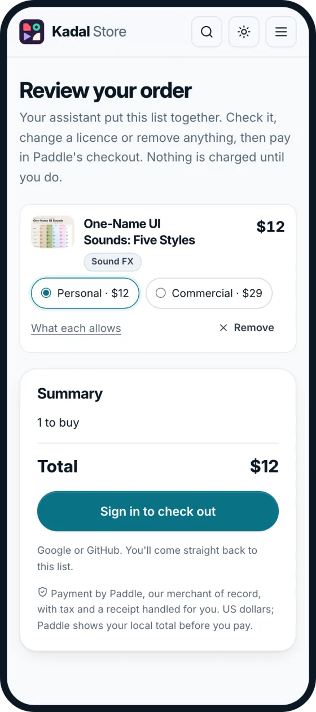
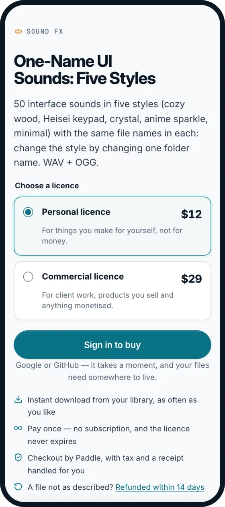
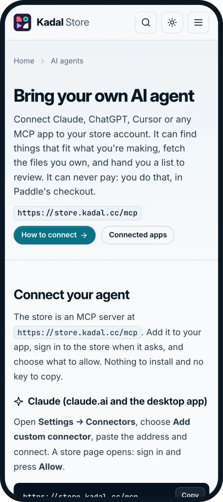

<h1 align="center">Kadal Store CLI</h1>

<h3 align="center">Your store library, in your terminal and your AI agent.</h3>

<p align="center">
  Find what fits the project you're in, put the files you own where they belong, and get a link to
  buy the rest. From a terminal, or from Claude, ChatGPT, Cursor, VS Code, Codex or any MCP app, on
  your own store account. Your agent can never pay.
</p>

<p align="center">
  <a href="https://www.npmjs.com/package/@kadal/store"></a>
  <a href="https://github.com/kadalcc/store-cli/actions/workflows/ci.yml"></a>
  <a href="https://github.com/kadalcc/store-cli/blob/main/LICENSING.md"></a>
  <a href="https://registry.modelcontextprotocol.io/v0/servers?search=cc.kadal/store"></a>
  <a href="https://github.com/sponsors/pmithunish"></a>
</p>

[The Kadal Store](https://store.kadal.cc) sells digital downloads: planners and printables, art
and icons, stickers, wallpapers, patterns, music, sound effects, 3D models, video FX and shaders.
You pay once and keep the files. `@kadal/store` brings the store to where you work. Search it, get
suggestions for the project in front of you, download and sync what you own, and get a link to buy
the rest. It works the same for you in a terminal and for the AI agent you already use, on your own
account and your own model subscription.

An agent can find things, download what you own and hand you a link. It can never pay: payment
happens in Paddle's checkout, on the store's own page, in front of you.

<p align="center">
  <a href="https://store.kadal.cc/agents/">
    
  </a>
</p>

<p align="center">
  <a href="https://store.kadal.cc"><strong>Browse the store →</strong></a><br>
  <sub>Every product shows its files, its editions and what each licence allows.</sub>
</p>

<p align="center">
  <a href="#start-in-30-seconds">Start</a> ·
  <a href="#connect-your-agent">Connect your agent</a> ·
  <a href="#commands">Commands</a> ·
  <a href="#your-agent-never-pays">Never pays</a> ·
  <a href="#privacy">Privacy</a> ·
  <a href="https://github.com/kadalcc/store-cli/blob/main/CHANGELOG.md">Changelog</a>
</p>

---

## Start in 30 seconds

You need Node 20 or newer.

```sh
npx -y @kadal/store login                                   # once: approve on the store's own page
npx -y @kadal/store recommend "ui sounds" --from .          # what fits the project you're in
npx -y @kadal/store download soft-ui-sounds -o assets/sfx   # a product you own, into the project
```

Or install it with `npm i -g @kadal/store`, then run `kadal-store <command>`.

Rather have your agent do it? Give Claude, ChatGPT, Cursor or VS Code the address
`https://store.kadal.cc/mcp`. There is nothing to install: [Connect your agent](#connect-your-agent).

## In the store

<table>
<tr>
<td align="center" width="25%"><a href="https://store.kadal.cc/p/soft-ui-sounds"></a><br><b>Soft UI Sounds</b><br><sub>Sound FX · <code>soft-ui-sounds</code></sub></td>
<td align="center" width="25%"><a href="https://store.kadal.cc/p/adhd-friendly-planner"></a><br><b>2027 ADHD-Friendly Daily Planner</b><br><sub>Printables · <code>adhd-friendly-planner</code></sub></td>
<td align="center" width="25%"><a href="https://store.kadal.cc/p/desk-workshop-kit"></a><br><b>Desk &amp; Workshop Kit</b><br><sub>3D · <code>desk-workshop-kit</code></sub></td>
<td align="center" width="25%"><a href="https://store.kadal.cc/p/liquid-marble"></a><br><b>Liquid Marble Shader</b><br><sub>Shaders · <code>liquid-marble</code></sub></td>
</tr>
<tr>
<td align="center" width="25%"><a href="https://store.kadal.cc/p/interface-line"></a><br><b>Interface Line Icons</b><br><sub>Art &amp; icons · <code>interface-line</code></sub></td>
<td align="center" width="25%"><a href="https://store.kadal.cc/p/sunset-arcs-cream"></a><br><b>Sunset Arcs</b><br><sub>Patterns · <code>sunset-arcs-cream</code></sub></td>
<td align="center" width="25%"><a href="https://store.kadal.cc/p/snowfall-overlays"></a><br><b>Snowfall Overlays</b><br><sub>Video FX · <code>snowfall-overlays</code></sub></td>
<td align="center" width="25%"><a href="https://store.kadal.cc/p/lofi-study-loops"></a><br><b>Lo-fi Study Loops</b><br><sub>Audio · <code>lofi-study-loops</code></sub></td>
</tr>
</table>

The code under each picture is the product's slug, which every command takes:
`kadal-store show liquid-marble` prints its files, prices and licence in the terminal. The pictures
are the store's own previews, so they change when the store does.

## Sign in

```text
$ kadal-store login
Opening your browser to sign in to store.kadal.cc. If it does not open, visit:
  https://store.kadal.cc/authorize?response_type=code&client_id=…
Signed in as Ana <ana@example.com> on store.kadal.cc. Saved to /home/ana/.config/kadal/store.json
```

You sign in on the store's own page, so your password never passes through the CLI. The token is
saved in `~/.config/kadal/store.json` (`$XDG_CONFIG_HOME` is respected; `%APPDATA%\kadal\` on
Windows), readable only by you, and renews itself. On a machine without a browser, use
`--no-open`, open the address anywhere, and paste the address the browser lands on back into the
terminal. If the store's page says it does not know this app, run `kadal-store login --register`.
`kadal-store logout` signs this machine out and revokes its access; so does removing
"Kadal Store CLI" under **Account → Settings → Connected apps**.

## Commands

### Find

```text
$ kadal-store search planner --max 10 --limit 5
72 Seasons Weekly Planner         Printables  $9.00               seventy-two-seasons-planner
Kakeibo Budget Planner            Printables  $8.00               kakeibo-budget-planner
2027 Small Business Planner       Printables  $8.00               small-business-planner-2027
2027 ADHD-Friendly Daily Planner  Printables  $8.00               adhd-friendly-planner
Christmas Planner                 Printables  $7.00               christmas-planner

5 of 54. Details: kadal-store show <slug>
More: kadal-store search planner --cursor 5
```

- `search <words…>` with `--shelf <slug>`, `--style`, `--topic`, `--format`, `--kind asset|pack`,
  `--max <dollars>`, `--sort relevance|newest|price`, `--limit <1-50>` (20), `--cursor <next page>`.
- `shelves` lists the store's shelves and how many products each holds (use a slug with `--shelf`).
- `show <slug>`: the price of each licence, what each licence allows and doesn't, the files with
  their sizes and editions, what a pack holds, and its updates.

### Suggestions for your project

```text
$ kadal-store recommend "sounds for a cosy pixel-art farming game" --limit 3
Retro 8-Bit SFX  Sound FX  from $9.00          retro-8bit-sfx
    Matches “sound”, “pixel” and “art” in its tags.
Cute Pops & Sparkles  Sound FX  from $9.00          cute-pops-sparkles
    Matches “sound”, “cosy” and “game” in its tags.
Holiday Creator Kit  Bundles  from $29.00         holiday-creator-kit  (pack of 9)
    Matches “sound”, “art” and “game” in its tags.

Packs that complete what you have:
Sound FX Collection  Sound FX  from $24.00         sfx-collection  (pack of 4)
    Holds 2 of the picks above. You already own 1 of its 4 items. Its 4 items cost $39 one by one; the pack is $24. (you own 1)
…
```

Every pick says why it was picked, and a pack says what it would save you. What you own is left out
(`--include-owned` keeps it). Add `--from .` and the store also reads a short summary of the project
you're in, which you see before it goes ([what it holds](#privacy)). Also `--shelf`, `--format`
(both repeatable), `--max <dollars>`, `--limit <1-20>` (8), and `--yes` to send the summary without
asking.

### What you own

```text
$ kadal-store library
Slim Weekly Techo  (standard)  42 files, 19.7 MB  slim-weekly-techo
Soft UI Sounds  (personal)  41 files, 1.8 MB  soft-ui-sounds

Download one: kadal-store download <slug> · everything: kadal-store sync <dir>

$ kadal-store download slim-weekly-techo --year 2027 --lang en --size a6 -o planner
Downloading slim-weekly-techo into planner
  ✓ planner/FONT-LICENCE.txt
  ✓ planner/how-to-print.pdf
  ✓ planner/slim-weekly-techo_2027_en_a6.pdf
Done: 3 downloaded, 0 already here.

$ kadal-store sync Kadal
2 products · 83 files already in Kadal · 0 to download
Done: 0 downloaded, 83 already here.
```

- `download <slug>` puts one product's files in `./<slug>` (or `-o <dir>`). `--file <name>`
  (repeatable) picks files. A product sold in editions takes `--year 2027 --week sun|mon
  --lang en|ja|en-ja --size a4|a5|letter…` to pick one; `show <slug>` lists the editions it has.
  Files that belong to every edition, like the read-me, always come too. `--zip` gets the whole
  product as one zip, and `--force` downloads files that are already there.
- `sync [dir]` mirrors everything you own into `dir` (default `./kadal-store`), one folder per
  product. Files already there with the same sha256 are skipped; nothing is ever deleted.
  `--product <slug>` (repeatable), the edition flags, and `--dry-run` to see what would come down.
- Recolourable illustrations (`show <slug>` says "Recolourable") come in any colour:
  `--color <hex>` on `download` or `sync`, such as `--color 2f9e44`, saves each SVG in that colour
  as `<name>-2f9e44.svg`, and the rest of the product as it is. Leave out the `#` or quote it
  (`"#2f9e44"`): a bare `#` starts a comment in the shell. Each recoloured file is checked against
  the store's sha256 for it, so the next run skips it too. `sync --color` recolours the products
  that can be and brings the rest as drawn; a product that can't take a colour is refused (exit 2).
- Every file is checked against the sha256 the store gives before it is kept. A download that is
  cut off leaves a `.kadal-part` file, and the next run picks up where it stopped. Downloads run
  four at a time (`--concurrency <n>`).
- Only what you own downloads. Anything else stops with the store's answer:

  ```text
  $ kadal-store download retro-8bit-sfx
  Downloading retro-8bit-sfx into retro-8bit-sfx
  error: You don't own Retro 8-Bit SFX. get_product describes it; create_buy_link makes a link to buy it.
  ```

### Buy

```text
$ kadal-store buy retro-8bit-sfx soft-ui-sounds
Review and pay here:
  https://store.kadal.cc/buy?items=retro-8bit-sfx:personal,soft-ui-sounds:personal&ref=cli

  Retro 8-Bit SFX                           personal    $9.00
  Soft UI Sounds                            personal    $9.00  (you already own this)
  Total                                                 $9.00

Open the link to review and pay. Nothing is charged until you pay on that page, and you can change a licence or remove anything there. Already owned, so not charged: soft-ui-sounds.
```

`buy <slug[:tier]>…` makes a page where you see each item, its licence and its price, and anything
you already own, which is left out of the total. Without a tier, an item comes with the cheapest
licence on sale for it; add one (`personal`, `standard` or `commercial`) to choose. `--open`
opens the page in your browser. Making that page is all `buy` does: you pay there, or not at all.

<p align="center">
  
  
  <br>
  <sub>Left, what <code>buy</code> and an agent's <code>create_buy_link</code> open: a list for you to check. Right, the product page, where each licence is explained.</sub>
</p>

### Tell us about a problem

```text
$ kadal-store report slim-weekly-techo --kind question --file slim-weekly-techo_2027_en_a6-on-a4.pdf --page 3 "Do I print this one at 100% for an A6 binder?"
Thanks. Your note is open: https://store.kadal.cc/account/notes#note_…
Only you and Kadal can see it. Replies show up in `kadal-store notes`.

$ kadal-store notes
  Slim Weekly Techo · question · slim-weekly-techo_2027_en_a6-on-a4.pdf  [Waiting for Kadal to read it]  note_…
    Do I print this one at 100% for an A6 binder?
```

`--kind mistake|question|idea`; `--page <n>` for a PDF, `--at <seconds>` for audio or video. Use
`-` in place of the words to read them from stdin. `notes --status
open|accepted|declined|duplicate|fixed` narrows the list. When a fix ships, the product's update
shows in your library and the next `download` or `sync` gets it.

### Everything else

`whoami`, `logout`, `--help` (and `<command> --help`), `--version`.

## Connect your agent

<p align="center">
  <a href="https://store.kadal.cc/agents/"></a>
  <br>
  <sub>The same steps, with copy buttons: <a href="https://store.kadal.cc/agents/">store.kadal.cc/agents</a>.</sub>
</p>

There are two servers with the same tools. The **hosted** one, `https://store.kadal.cc/mcp`, needs
nothing installed: your app signs in to the store with OAuth, and you choose what to allow. The
**local** one, `npx -y @kadal/store mcp`, uses this machine's `kadal-store login` and adds two tools
that work on the project folder. Both are one entry, `cc.kadal/store`, in the
[official MCP Registry](https://registry.modelcontextprotocol.io/v0/servers?search=cc.kadal/store).

### Claude (claude.ai and the desktop app)

Open **Settings → Connectors**, choose **Add custom connector**, paste `https://store.kadal.cc/mcp`
and connect. A store page opens: sign in and press **Allow**.

### Claude Code

The plugin brings the skill and the local MCP server together. Sign in once with
`npx -y @kadal/store login`, then:

```text
/plugin marketplace add kadalcc/store-cli
/plugin install kadal-store@kadal-store
```

Or add the hosted server alone, then run `/mcp` in Claude Code and pick **kadal-store** to sign in:

```sh
claude mcp add --transport http kadal-store https://store.kadal.cc/mcp
```

Or the local server alone: `claude mcp add kadal-store -- npx -y @kadal/store mcp`.

### ChatGPT

In **Settings → Apps & Connectors**, turn on developer mode under **Advanced**, then create a
connector with the address `https://store.kadal.cc/mcp` and OAuth as the sign-in. ChatGPT opens the
store's sign-in the first time you use it.

### Cursor

Add it to `~/.cursor/mcp.json`:

```json
{ "mcpServers": { "kadal-store": { "url": "https://store.kadal.cc/mcp" } } }
```

### VS Code

Add it to `.vscode/mcp.json`, then start it from the file:

```json
{ "servers": { "kadal-store": { "type": "http", "url": "https://store.kadal.cc/mcp" } } }
```

### Codex, and apps that only run local servers

Sign in once with `npx -y @kadal/store login`, then point the app at the local server. In Codex,
that is `~/.codex/config.toml`:

```toml
[mcp_servers.kadal-store]
command = "npx"
args = ["-y", "@kadal/store", "mcp"]
```

Claude Desktop, Cursor and other apps take the same local server as JSON:

```json
{ "mcpServers": { "kadal-store": { "command": "npx", "args": ["-y", "@kadal/store", "mcp"] } } }
```

### The skill

For any agent that reads Agent Skills: `npx skills add kadalcc/store-cli`
([skills/kadal-store](https://github.com/kadalcc/store-cli/blob/main/skills/kadal-store/SKILL.md)).
It teaches the agent to find assets for the project in front of it, download into it, never buy on
its own, and report problems it finds in files you bought.

### The tools

| MCP tools | |
| --- | --- |
| `search_products`, `get_product`, `list_shelves`, `recommend` | the catalogue, the licence of each product, suggestions from a description of the work |
| `list_library`, `get_download_links` | what you own, and ten-minute download links with each file's sha256 (a recolourable illustration's SVGs in the `color` you give) |
| `create_buy_link` | a review page for you to pay on; it charges nothing |
| `report_problem`, `list_my_notes` | a note about a file you own, and Kadal's replies |
| `whoami` | who is signed in, with which scopes |
| `project_summary` (local) | what `recommend --from` sends: the folder described without its contents |
| `download_to_folder` (local) | files you own into the project, checked by sha256, skipping what is there, in a `color` for recolourable illustrations; only inside the folder the server started in unless it was started with `--allow-outside` |

`kadal-store mcp --dir <path>` serves another folder as the project. Every tool needs the
`store:read` scope except `report_problem`, which needs `store:write`. The store's
[server card](https://store.kadal.cc/.well-known/mcp/server-card.json) lists every tool without
signing in.

[](https://glama.ai/mcp/connectors/cc.kadal/store)
[](https://glama.ai/mcp/servers/kadalcc/store-cli)

## Your agent never pays

- **No tool can pay.** `create_buy_link`, like `kadal-store buy`, returns the address of a review
  page on store.kadal.cc. You pay there, in Paddle's checkout, in your own browser, signed in to
  the store. Nothing is charged until you do, and you can change a licence or remove anything first.
- **Downloads are only for what you own.** Download links are made for the signed-in person, for
  the files their licence covers, and last ten minutes. Anything else gets "You don't own …" and a
  pointer to `create_buy_link`.
- **You choose what it may do.** Reporting a problem needs `store:write`; everything else is
  `store:read`. Remove an app under **Account → Settings → Connected apps** and its access ends.
- **The skill says so too.** It tells the agent never to buy, never to say something was bought,
  never to open a checkout for you, and to ask you to sign in yourself.

## Privacy

`recommend --from <dir>` and the local server's `project_summary` describe a project without its
contents. They read:

- from `package.json`, `pyproject.toml`, `Cargo.toml` or `go.mod`: the name, description, keywords
  and the **names** of dependencies (never versions, scripts or anything else);
- the README's **headings**, not its paragraphs;
- **file names**, to count file types and spot tools (a `project.godot`, `.blend` files), and the
  top-level names.

Dependency, build and hidden folders (`node_modules`, `.git`, `dist`, any dot folder…) are not
read, symlinks are not followed, and the text is capped at 6,000 characters. You see exactly what
will be sent, and nothing goes until you say yes:

```text
$ kadal-store recommend "ui sounds" --from .
This summary of /home/ana/cosy-farm will be sent to store.kadal.cc:

  Project: cosy-farm — A cosy farming game
  Built with: Phaser, Vite
  Dependencies: phaser, vite
  README sections: Cosy Farm · Art style · Controls
  File types: .png 8, .ts 5, .html 1, .json 1, .md 1
  Top level: assets/, src/, index.html, package.json, README.md

Send it? [y/N]
```

The folder's path is shown to you and not sent. With no terminal to ask in, nothing is sent unless
you pass `--yes`.

On the store's side, the words sent to `recommend` are used for that one answer and not kept. Each
connection records the app's name, what you allowed and when, and downloads are logged as they are
from your library. More in the store's [privacy policy](https://store.kadal.cc/privacy/). On your
machine, the CLI keeps only its sign-in, as [Sign in](#sign-in) describes.

## How it works

<p align="center">
  
</p>

Whatever the CLI asks the store, it asks as a call to a tool of the hosted MCP server
(`POST https://store.kadal.cc/mcp`, Streamable HTTP, OAuth 2.1 with PKCE). It holds no catalogue
logic of its own, so the CLI, `kadal-store mcp` and an agent on the hosted server all see the same
data. The tools are described on [store.kadal.cc/agents](https://store.kadal.cc/agents/#tools) and
in the server card, and their types are in
[`src/types.ts`](https://github.com/kadalcc/store-cli/blob/main/src/types.ts). Money is always
integer US cents; URLs are absolute. The drawing is an
[Excalidraw file](https://github.com/kadalcc/store-cli/blob/main/.github/assets/how-it-works.excalidraw).

## For scripts

- `--json` on any command prints one JSON document on stdout; everything meant for people goes to
  stderr. For the store's commands it is the store tool's answer exactly as the store sent it.
  `download` prints `{slug, dir, files: [{slug, fileId, name, path, bytes, sha256, status,
  resumed?, error?}], zip, counts}`, `sync` prints `{dir, dryRun, files, counts}`, `login` prints
  `{ok, host, user, scopes, operator, config}`, `logout` prints `{ok, host, signedOut, revoked}`,
  and a `recommend --from` you declined prints `{sent: false}`. Errors are
  `{ok: false, error: {code, message, exitCode}}`.
- Exit codes: `0` ok, `1` failed (the message says why), `2` usage, `3` not signed in (or the
  sign-in expired: run `kadal-store login`), `4` a download failed its checksum (nothing was kept).
- `--host <url>` or `KADAL_STORE_HOST` points at another store, such as a local worker
  (`--host http://localhost:8861`). Each host keeps its own sign-in.

## Development

```sh
bun install && bun run build && bun run test
bun test/fake-store.ts 8899 &                      # a fake store, no account needed
node dist/bin.js login --host http://127.0.0.1:8899
```

See [CONTRIBUTING.md](https://github.com/kadalcc/store-cli/blob/main/CONTRIBUTING.md) and
[AGENTS.md](https://github.com/kadalcc/store-cli/blob/main/AGENTS.md). The pictures in this README
come from live pages and real runs of the CLI;
[`.github/assets/src/render.mjs`](https://github.com/kadalcc/store-cli/blob/main/.github/assets/src/render.mjs)
remakes them.

## Licence

**[AGPL-3.0-or-later](https://github.com/kadalcc/store-cli/blob/main/LICENSE)**, like the
[Kadal Deck](https://github.com/kadalcc/deck) engine. Running the CLI, as a command or as your
agent's MCP server, triggers nothing. If you run a **modified** version as a network service, its
users must be able to get your modified source.

The files you download are not under the AGPL: each comes with the store licence you bought it
with. [LICENSING.md](https://github.com/kadalcc/store-cli/blob/main/LICENSING.md) explains both,
and [THIRD_PARTY_NOTICES.md](https://github.com/kadalcc/store-cli/blob/main/THIRD_PARTY_NOTICES.md)
lists the packages installed beside it, with their licences.

## Contributing

A bug report with the command you ran, its `--json` output and the exit code is the most useful
thing you can send, and pull requests are welcome.
[CONTRIBUTING.md](https://github.com/kadalcc/store-cli/blob/main/CONTRIBUTING.md) covers the setup
(Bun 1.3+) and the tests. Please follow the
[code of conduct](https://github.com/kadalcc/store-cli/blob/main/CODE_OF_CONDUCT.md), and report
security issues privately as
[SECURITY.md](https://github.com/kadalcc/store-cli/blob/main/SECURITY.md) describes.

## Sponsors

Sponsorships pay for time on Kadal's open-source tools: issues, docs and the features you ask for.
**[Sponsor Kadal on GitHub](https://github.com/sponsors/pmithunish)**. It is the same sponsorship
as Kadal Deck's: the tiers are on [deck.kadal.cc/sponsor](https://deck.kadal.cc/sponsor/), and
backers are listed in [BACKERS.md](https://github.com/kadalcc/store-cli/blob/main/BACKERS.md).
Companies can sponsor
[by invoice](https://docs.github.com/en/sponsors/sponsoring-open-source-contributors/paying-for-github-sponsors-by-invoice).

<!-- sponsors: Gold, Silver and Bronze logos and Patron avatars go here, largest first -->
<p align="center">
  <a href="https://github.com/sponsors/pmithunish"><strong>Your logo here</strong></a>:
  be the first company to sponsor Kadal's open-source work.
</p>
<!-- /sponsors -->

<p align="center">
  <sub>Made in Chennai, India by <a href="https://kadal.cc">Kadal</a> · <a href="https://store.kadal.cc">store.kadal.cc</a> · <a href="mailto:hello@kadal.cc">hello@kadal.cc</a> · <a href="https://work.kadal.cc/contact/">Contact and office</a></sub>
</p>
